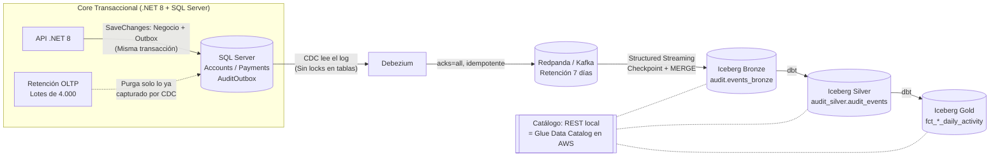

# Arquitectura de Retención y Lakehouse para Auditoría (.NET 8 + SQL Server → Iceberg + dbt)

Cuando un core transaccional en **.NET 8 y SQL Server** escala, las tablas de auditoría e hiper-logs suelen convertirse en un dolor de cabeza silencioso: crecen sin freno, compiten por I/O y locks con las operaciones críticas del negocio, inflan los backups y vuelven arriesgada cualquier purga masiva.

Esta prueba de concepto resuelve ese problema desacoplando el ciclo de vida de los logs mediante un **Lakehouse moderno**:

1. **El core (.NET 8)** guarda el evento de auditoría dentro de la misma transacción de negocio usando el patrón **Transactional Outbox** (sin hablar directamente con el broker).
2. **Debezium (CDC)** lee el log de transacciones de SQL Server de forma asíncrona y envía los eventos a un buffer durable (**Redpanda / Kafka**).
3. **PySpark Structured Streaming** ingesta los eventos de manera idempotente hacia **Apache Iceberg** (capa *Bronze*).
4. **dbt** transforma, limpia y agrega los datos en capas *Silver* y *Gold* con pruebas de calidad automatizadas.
5. **SQL Server** queda libre para purgar en lotes pequeños lo que ya fue capturado, conservando únicamente una ventana caliente.



---

## 1. Guía rápida: Levantar y verificar la PoC

El entorno está diseñado para que con un solo comando levante toda la infraestructura, simule tráfico de negocio y valide de punta a punta que no se pierda ni duplique un solo evento.

**Requisitos:** Docker con Compose v2 (probado en Windows con Docker Desktop; se recomiendan ~8 GB de RAM asignados).

### En PowerShell (Windows)
```powershell
# 1. Preparar variables de entorno
Copy-Item .env.example .env

# 2. Levantar el flujo completo y ejecutar validación E2E
docker compose up -d --build

# 3. Esperar a que dbt construya Silver/Gold y corra sus tests
docker compose wait dbt

# 4. Consultar el veredicto en lenguaje claro
powershell -ExecutionPolicy Bypass -File .\scripts\resultado.ps1
```

### En Git Bash / Linux / macOS
```bash
cp .env.example .env
docker compose up -d --build
docker compose wait dbt
bash scripts/resultado.sh
```

> **Nota sobre tiempos:** La primera ejecución descarga imágenes base, paquetes de Spark (cacheados en volumen) y compila .NET y dbt. Las corridas posteriores toman alrededor de 1 a 2 minutos.

### ¿Qué sucede automáticamente al hacer `up`?
1. **`e2e` (`spark/jobs/verify_e2e.py`):** Espera a que la API y el conector CDC estén listos, genera tráfico real contra .NET (`POST /api/simulate`) y reconcilia registro por registro (`event_id`) SQL Server contra Iceberg Bronze hasta converger.
2. **`dbt`:** Se dispara únicamente si `e2e` aprueba. Verifica la frescura de los datos y construye las capas *Silver* y *Gold* ejecutando **22 tests de calidad y reconciliación**.

#### Evidencia de ejecución real
```text
RESULTADO DE LA PRUEBA DE CONCEPTO

  PRUEBA END-TO-END: APROBADA (E2E PASS)
  SQL Server -> Debezium -> Kafka -> Spark -> Iceberg

  Operaciones de negocio simuladas : 20 cuentas, 1738 pagos, 176 reversos
  Eventos en SQL Server (acumulado) : 4848
  Eventos en el lakehouse (acumul.) : 4848
  Eventos perdidos                  : 0
  Eventos duplicados                : 0
  Tiempo hasta quedar sincronizado  : 23 s

  Tests de calidad de datos (dbt): 22 de 22 aprobados, 0 con error

  [OK] E2E  - SQL Server llega completo al lakehouse, sin perdidas ni duplicados
  [OK] dbt  - capas silver y gold construidas y validadas

VEREDICTO: APROBADA
```

**Cómo se lee:** se solicitan 2000 pagos, pero la simulación usa 8 hilos sobre solo 20 cuentas. Cuando dos
pagos tocan el mismo saldo a la vez, la concurrencia optimista (`rowversion`) confirma uno y rechaza el otro.
El rechazado no se confirma y **no genera eventos**, por eso se confirman 1738 y no 2000. Cada pago y cada
reverso generan 2 eventos (el pago y el saldo de la cuenta), así que el total cuadra exacto:

```
1000 iniciales (init.sql) + 20 cuentas x1 + 1738 pagos x2 + 176 reversos x2 = 4848
```

*(Si deseas volver a validar después de hacer pruebas manuales por la API sin regenerar tráfico masivo, ejecuta `.\scripts\resultado.ps1 -Actualizar` o `bash scripts/resultado.sh --actualizar`).*

### Probar resiliencia ante caídas y rastreo manual

Puedes simular una caída del pipeline mientras el core sigue recibiendo tráfico y comprobar que se recupera
solo. El script ejecuta los pasos, narra cada uno con hora y conteos, y guarda la evidencia en
`evidencia/prueba-caida-<fecha>.txt`:

```powershell
powershell -ExecutionPolicy Bypass -File .\scripts\prueba-caida.ps1            # 3.000 transacciones
powershell -ExecutionPolicy Bypass -File .\scripts\prueba-caida.ps1 -Pagos 500 # más rápido
```

```bash
bash scripts/prueba-caida.sh        # Git Bash / Linux / macOS (opcional: cantidad de pagos)
```

Evidencia real:

```
[2026-11-25 15:44:42] PASO 0 - Estado inicial
           Antes: SQL Server = 18433 eventos | lakehouse = 18433 | pendientes de llegar = 0
[2026-11-25 15:44:53] PASO 1 - Se apagan la captura (Debezium) y la ingesta (Spark)
           connect: exited
           spark-ingest: exited
[2026-11-25 15:44:57] PASO 2 - El core .NET sigue operando: 3000 transacciones de pago con el pipeline caido
           Respuesta del core en 3865 ms (sin depender del pipeline):
             3000 pagos solicitados = 2616 confirmados + 384 rechazados por concurrencia + 0 rechazados por saldo
             253 reversos confirmados (7 reversos rechazados por concurrencia)
             Un rechazo no confirma la transaccion: no cambia el saldo y no genera eventos (outbox atomica).
             Eventos esperados: 20 cuentas x1 + 2616 pagos x2 + 253 reversos x2 = 5758
[2026-11-25 15:45:01] PASO 3 - Con el pipeline caido, los eventos esperan en SQL Server (no se pierden)
           Durante la caida: SQL Server = 24191 eventos | lakehouse = 18433 | pendientes de llegar = 5758
           Nuevos en SQL Server: 5758 (esperados 5758: coincide) | nuevos en el lakehouse: 0
[2026-11-25 15:45:13] PASO 4 - Se levanta el pipeline: Debezium retoma desde su ultimo LSN y Spark desde su checkpoint
[2026-11-25 15:45:15] PASO 5 - Reconciliacion evento por evento (SQL Server vs lakehouse) hasta quedar al dia
           Recuperacion completa en 17 s desde que se levanto el pipeline
[2026-11-25 15:45:32] PASO 6 - dbt reconstruye silver y gold y valida las capas
  Eventos en SQL Server (acumulado) : 24191
  Eventos en el lakehouse (acumul.) : 24191
  Eventos perdidos                  : 0
  Eventos duplicados                : 0
VEREDICTO: APROBADA
```

Si prefieres ejecutar los pasos a mano en PowerShell:

```powershell
docker compose stop connect spark-ingest                                                        # 1. pipeline caido
Invoke-RestMethod -Method Post -Uri "http://localhost:5080/api/simulate?accounts=20&payments=3000"  # 2. el core sigue
docker compose start connect spark-ingest                                                       # 3. recuperacion
powershell -ExecutionPolicy Bypass -File .\scripts\resultado.ps1 -Actualizar                    # 4. reconciliar
```

### API del core y rastreo de un evento

Cada operación genera eventos de auditoría que viajan solos hasta el lakehouse:

| Endpoint | Eventos |
|---|---|
| `POST /api/accounts` | 1: la cuenta (`Account CREATE`) |
| `POST /api/payments` | 2: el pago (`Payment CREATE`) y el saldo de la cuenta (`Account UPDATE`) |
| `POST /api/payments/{id}/reverse` | 2: el pago (`Payment UPDATE`) y el saldo devuelto (`Account UPDATE`) |
| `POST /api/simulate?accounts=20&payments=2000` | Miles: tráfico masivo de prueba |

PowerShell:

```powershell
# Crear una cuenta (initialBalance es el saldo inicial, no una cantidad de registros)
$acc = Invoke-RestMethod -Method Post -Uri http://localhost:5080/api/accounts `
  -Headers @{ "X-Actor" = "ana" } -ContentType "application/json" `
  -Body '{"owner":"Acme","initialBalance":1000}'
$acc

# Pagar 40 con esa cuenta
$pay = Invoke-RestMethod -Method Post -Uri http://localhost:5080/api/payments `
  -ContentType "application/json" -Body ('{"accountId":"' + $acc.id + '","amount":40}')
$pay

# Revertir el pago y consultar la cuenta
Invoke-RestMethod -Method Post -Uri "http://localhost:5080/api/payments/$($pay.id)/reverse"
Invoke-RestMethod -Uri "http://localhost:5080/api/accounts/$($acc.id)"

# Rastrear los eventos de la cuenta por todo el pipeline
powershell -ExecutionPolicy Bypass -File .\scripts\rastrear.ps1 $acc.id
```

Git Bash / Linux / macOS:

```bash
curl -X POST localhost:5080/api/accounts -H 'Content-Type: application/json' \
     -H 'X-Actor: ana' -d '{"owner":"Acme","initialBalance":1000}'
curl -X POST localhost:5080/api/payments -H 'Content-Type: application/json' \
     -d '{"accountId":"<id-cuenta>","amount":40}'
curl -X POST localhost:5080/api/payments/<id-pago>/reverse
curl localhost:5080/api/accounts/<id-cuenta>
bash scripts/rastrear.sh <id-cuenta-o-pago>
```

`rastrear` muestra en qué etapa está cada evento de esa cuenta o pago (resultado real):

```
1) SQL Server - evento guardado junto con la operacion de negocio
   [OK] 2 evento(s)
        46fa11a9-... | Account CREATE | 2026-11-25 20:19:32 | en outbox y capturado por CDC
        0e892964-... | Account UPDATE | 2026-11-25 20:19:32 | en outbox y capturado por CDC

2) Kafka -> Spark -> Iceberg bronze (automatico, cada ~30 s)
   [OK] 2 de 2 evento(s) en el lakehouse
        46fa11a9-... | Account | CREATE | 2 | 5720 | 2026-11-25 20:20:00.004
        0e892964-... | Account | UPDATE | 0 | 5865 | 2026-11-25 20:20:00.004

3) dbt silver (se actualiza al correr dbt, no es continuo)
   [OK] 2 de 2 evento(s) en silver
```

- Si se consulta enseguida, la etapa 2 aparece como `[..] todavia en camino`. La ingesta corre cada 30 s.
- Silver se actualiza al correr dbt: `docker compose run --rm --no-deps dbt`.
- Pasada la ventana de retención (5 min en la PoC), la etapa 1 indica que el evento fue purgado de la
  outbox. Sigue existiendo en la tabla de CDC y en el lakehouse.

---

### Mapa de servicios y herramientas opcionales

| Servicio | Función en la arquitectura | Puerto |
|---|---|---|
| `sqlserver` + `sqlserver-init` | Base transaccional OLTP con CDC habilitado exclusivamente sobre `AuditOutbox` | `1433` |
| `core-api` | API en .NET 8 (operaciones de negocio, interceptor de auditoría y purga controlada) | `5080` |
| `connect` + `connect-register` | Debezium 2.7 leyendo el transaction log de SQL Server | `8083` |
| `redpanda` + `redpanda-init` | Broker compatible con Kafka (3 particiones, retención de 7 días) | `9092` |
| `objectstore` + `objectstore-init` | Almacenamiento S3 local (SeaweedFS) con UI para explorar el bucket `warehouse` | `8333` / `8888` |
| `iceberg-rest` | Catálogo Iceberg REST (equivalente local a AWS Glue Data Catalog) | `8181` |
| `spark-ingest` | Streaming continuo en PySpark hacia Iceberg Bronze | `4040` |

```bash
docker compose --profile ui up -d redpanda-console   # Consola visual de tópicos y Debezium (:8085)
docker compose run --rm spark-maintenance             # Compactación, limpieza de snapshots y huérfanos
docker compose run --rm spark-inspect                 # Inspección de particiones, archivos y duplicados
docker compose --profile load up -d load-generator   # Carga cruda directa sobre la outbox (sin pasar por la API)
docker compose down -v                                # Limpiar contenedores y volúmenes
```

---

## 2. Decisiones de Arquitectura

### Eje A: Desacoplamiento en .NET 8 y SQL Server (sin bloqueos ni pérdida)

En lugar de elegir una sola técnica aislada, combinamos **Transactional Outbox + CDC + Buffer durable**, aprovechando lo mejor de cada una:

* **Atomicidad sin *dual-write*:** Mediante un `SaveChangesInterceptor` de EF Core (`AuditOutboxInterceptor.cs`), cada cambio en entidades auditables genera una fila en `dbo.AuditOutbox` dentro de la **misma transacción** de negocio. Si el pago hace rollback, el log tampoco nace. El core nunca habla directo con Kafka; en pruebas con el pipeline apagado procesó 3.000 transacciones en 3,9 s (5.728 eventos) sin enterarse de la caída.
* **Diseño físico pensado para no fragmentar:** La tabla `AuditOutbox` es angosta, *append-only* y usa `NEWSEQUENTIALID()` generado en cliente para insertar siempre al final del índice, evitando *page splits* y contención. Además, el interceptor soporta `[AuditIgnore]` para excluir campos técnicos o datos sensibles (PII).
* **CDC solo sobre la Outbox:** Habilitamos CDC únicamente en `dbo.AuditOutbox` y no sobre `Accounts` o `Payments`. Esto desacopla el modelo interno del dominio frente al contrato analítico (`SchemaVersion`) y conserva contexto de negocio (actor, acción semántica como `REVERSED`).
* **Retención controlada en OLTP:** Un servicio en segundo plano (`OutboxRetentionService`) purga registros antiguos en **lotes de 4.000 filas** (por debajo del umbral de ~5.000 locks donde SQL Server escala a bloqueo de tabla) y **solo si CDC ya los capturó** (`EXISTS` en `cdc.dbo_AuditOutbox_CT`). En pruebas purgó 21.000 filas dejando SQL Server en 5.733 mientras el Lakehouse conservó los 26.733 completos.

### Eje B: Diseño del Data Lakehouse (Iceberg + dbt + Glue)

#### 1. Modelado por capas
* **Bronze (`lake.audit.events_bronze`):** Alimentada por PySpark Streaming. Guarda el evento crudo junto con trazabilidad técnica (`cdc_op`, `cdc_commit_lsn`, `kafka_partition`, `kafka_offset`, `ingested_at`).
* **Staging (`stg_audit__events`):** Vista en dbt que parsea el JSON según su `schema_version`.
* **Silver (`audit_silver.audit_events`):** Modelo incremental en dbt con la traza limpia y deduplicada por `event_id`.
* **Gold (`fct_audit_daily_activity`, `fct_actor_daily_activity`):** Agregaciones diarias listas para reportes y auditoría.

#### 2. Particionamiento y ordenamiento
* Usamos **Hidden Partitioning** por día de negocio: `PARTITIONED BY (days(event_ts))`. Las consultas filtran por `event_ts` de forma natural sin depender de columnas artificiales (`dt`), y particionar por día (en vez de hora) evita multiplicar metadatos y archivos pequeños. Si el volumen crece a futuro, Iceberg permite evolucionar la partición sin reescribir el histórico.
* Al escribir, ordenamos localmente por `entity_id, event_ts` (`WRITE DISTRIBUTED BY PARTITION LOCALLY ORDERED BY...`). Esto reduce la cantidad de escritores concurrentes y alinea las estadísticas min/max de Parquet para acelerar la consulta más común: *"muéstrame el historial de esta entidad"*.

#### 3. Solución al *Small Files Problem* y ciclo de vida
Los micro-batches de 30 segundos generan archivos pequeños. El job `maintenance.py` resuelve esto operativamente:
1. **`rewrite_data_files` (sort, objetivo 128 MB):** En producción compacta solo particiones cerradas (`< hoy`) para no colisionar con el streaming activo.
2. **`rewrite_manifests`:** Mantiene ágil la planificación de consultas.
3. **`expire_snapshots` y `remove_orphan_files`:** Acota el *time travel* (24 h / mínimo 10 snapshots) y limpia archivos huérfanos con margen de seguridad de 3 días.
4. **Retención regulatoria:** Se ejecuta mediante `DELETE` alineado a días completos en Iceberg (descartando particiones en metadata sin reescribir datos). *Importante:* Nunca aplicamos políticas de expiración de S3 directamente sobre el bucket, ya que borrarían archivos referenciados por Iceberg y corromperían la tabla.

#### 4. ACID y evolución de esquemas
* **Inmutabilidad y *Merge-on-Read*:** Como la auditoría es *append-only*, ignoramos eventos `d` (deletes) provenientes de la purga del Outbox en SQL Server. Además, configuramos *merge-on-read* junto con un anti-join previo en dbt para evitar amplificación de escritura: en nuestras mediciones pasamos de reescribir 19.500 filas por corrida incremental (*copy-on-write*) a escribir solo **1 archivo nuevo con 1.500 filas y 0 archivos reescritos**.
* **Evolución en 3 niveles:** Nuevos campos de negocio viajan dentro del JSON versionado (`SchemaVersion`); nuevas columnas en Silver usan `on_schema_change='append_new_columns'`; y cambios en Bronze se gestionan mediante `ALTER TABLE` explícito en metadata sin reescribir histórico.

#### 5. Portabilidad hacia AWS Glue
En local usamos **Iceberg REST** porque Glue no tiene un contenedor oficial fiel, pero el código de Spark y dbt es idéntico. Pasar a AWS solo requiere cambiar el tipo de catálogo en `spark-defaults.conf`:

```properties
spark.sql.catalog.lake.type       glue
spark.sql.catalog.lake.warehouse  s3://<bucket-lakehouse>/
```

Con esto ganamos un catálogo unificado para Athena, EMR, Redshift y Glue Jobs, gobierno fino por columna/fila con **Lake Formation** (por ejemplo, enmascarando `payload_raw` a analistas) y optimización gestionada de tablas Iceberg.

---

## 3. Uso Orquestado de IA (Eje C)

Para acelerar la construcción de la PoC utilicé **Claude Code** apoyado en una *skill* especializada en Spark, trabajando de forma iterativa y validando **cada decisión con ejecución real y métricas** en Docker.

### Estrategia de prompts y conducción humana
1. **Construcción *bottom-up*:** En lugar de pedir todo el sistema de golpe, guié la generación empezando por infraestructura + ingesta de PySpark (*"Arma primero el docker-compose y el job de PySpark"*), asegurando primero cero pérdida de datos antes de sumar dbt y la API en .NET.
2. **Simplificación de experiencia de prueba:** Al notar que la validación requería varios pasos manuales, reorienté el diseño (*"El problema es que la prueba pide un entorno minimalista que levante el flujo end-to-end"*) para que `docker compose up` ejecutara y verificara todo automáticamente.
3. **Control de alcance:** Una vez probada la viabilidad técnica, congelé el código para enfocar el tiempo en documentar con claridad los *trade-offs* arquitectónicos.

### Errores e ineficiencias de la IA corregidos con criterio técnico

| Hallazgo / Propuesta de la IA | Cómo se detectó | Decisión y corrección aplicada |
|---|---|---|
| **MinIO como S3 local** | Falló `docker pull` al no haber imágenes públicas recientes | Se sustituyó por **SeaweedFS** + `aws-cli` para inicializar el bucket `warehouse`. |
| **Configuración S3 estándar en Iceberg** | `JsonParseException` al leer metadata (`83e;chunk-signature=...`) | SeaweedFS almacena literal el *framing* `aws-chunked` del SDK v2; se desactivó `chunked-encoding` y se ajustó la validación de checksums. |
| **Modelo incremental de dbt con `merge` estándar** | Al inspeccionar archivos en Iceberg, reescribía **19.500 filas** para agregar 2.500 | Se combinó un **anti-join previo** con **merge-on-read**, logrando 1 archivo nuevo y 0 reescrituras. |
| **`InvariantGlobalization=true` en .NET 8** | Error 500 en runtime (`en-us is an invalid culture identifier`) | Se eliminó la propiedad para compatibilidad completa con `Microsoft.Data.SqlClient`. |
| **Sintaxis Python 3.9+ (`removeprefix`) y `remove_orphan_files` por defecto** | Errores en contenedor Spark (Python 3.8 y error de esquema `s3://`) | Se ajustó a Python 3.8 y se habilitó `prefix_listing => true` usando `S3FileIO`. |
| **Arranque simultáneo de contenedores Spark** | Corrupción en caché de dependencias Ivy al descargar JARs en paralelo | Se añadió *healthcheck* en `spark-ingest` para serializar la resolución inicial de dependencias. |
| **Logs de registro de Debezium imprimiendo credenciales** | Revisión de seguridad sobre el script de registro | Se ocultó el body de respuesta del PUT dejando solo el código de estado HTTP. |

---

## 4. Respuestas a las Preguntas de Evaluación

### 1. ¿Por qué mantener logs en SQL Server es un antipatrón a escala y cuál es el costo-beneficio de llevarlos a Apache Iceberg?
Un motor OLTP está diseñado para transacciones cortas, concurrencia alta y datos vivos. Las tablas de hiper-logs tienen el comportamiento opuesto: escritura intensiva continua, crecimiento ilimitado y lecturas esporádicas de rango amplio. Mantenerlas en SQL Server degrada el *buffer pool*, satura el *transaction log*, encarece licencias y réplicas de alta disponibilidad, y convierte cualquier borrado histórico en un riesgo de bloqueo de tabla.

Al mover el histórico a **Apache Iceberg sobre S3**, el almacenamiento pasa a ser un orden de magnitud más económico (formato columnar Parquet comprimido + tiers fríos), el cómputo analítico es elástico bajo demanda, la retención regulatoria se resuelve descartando particiones en metadata y se gana *time travel* nativo para auditoría forense. A cambio de operar un pipeline asíncrono con latencia de segundos/minutos, **SQL Server se estabiliza en una ventana caliente acotada**.

### 2. ¿Qué responsabilidad exacta tienen PySpark vs. dbt, y por qué Glue Catalog facilita la gobernanza?
* **PySpark** se encarga de **mover y mantener físicamente** los datos: ingesta en streaming con manejo de estado (*checkpoints*), deduplicación técnica en aterrizaje y compactación/expiración de snapshots en Iceberg.
* **dbt** se encarga de **modelar y validar el negocio**: transformaciones SQL declarativas (Bronze → Silver → Gold), pruebas de calidad, frescura, linaje y reconciliación entre capas.

**AWS Glue Data Catalog** actúa como fuente única de verdad de metadatos y esquemas. Permite que motores distintos (Athena, EMR, Redshift, Glue Jobs) consulten exactamente las mismas tablas Iceberg sin duplicar datos ni rehacer modelos, centralizando políticas de seguridad por tabla/columna mediante **Lake Formation**.

### 3. Si el servicio de ingestión cae durante un pico en .NET, ¿cómo se garantiza cero pérdida y cuál es el mecanismo de replay?
Cada etapa persiste el evento antes de liberar al eslabón anterior:
1. **SQL Server (`AuditOutbox`):** Guarda el evento junto con la transacción de negocio y **no se purga** hasta que CDC lo ha capturado.
2. **Redpanda / Kafka:** Retiene los mensajes confirmados (`acks=all`) durante 7 días, absorbiendo cualquier pico como *lag* sin presionar a .NET ni a Spark.
3. **PySpark (`checkpointLocation` + `MERGE`):** Controla el volumen por micro-lote (`maxOffsetsPerTrigger`) y confirma offsets solo después de persistir en Iceberg.

**Mecanismos de replay:**
* *Caída transitoria de Spark:* Al reiniciar, retoma desde el último *checkpoint* y el `MERGE` por `event_id` absorbe cualquier reintento sin duplicar.
* *Reproceso completo de lógica:* Se reinicia el *checkpoint* para releer el tópico desde el inicio (verificado con 17.000 eventos reingresados y **0 duplicados**).
* *Caída mayor a la retención del broker:* `failOnDataLoss=true` detiene la ingesta con alerta explícita en lugar de omitir datos, permitiendo reconstruir desde un snapshot de Debezium sobre SQL Server. *(En producción, además, la purga del Outbox debe guiarse por una marca de agua confirmada en Iceberg y no solo por la captura de CDC).*

### 4. Menciona una alucinación o sugerencia ineficiente de la IA y cómo tu criterio sénior la corrigió
El caso más claro ocurrió en el modelo incremental de **dbt**. La IA generó una estrategia `merge` estándar que pasaba todos los tests funcionales, pero al auditar los archivos generados en Iceberg descubrimos que ejecutaba un *copy-on-write* que **reescribía la partición completa del día (19.500 filas) cada vez que insertaba 2.500 eventos nuevos**.

Para evitar esa amplificación de escritura en una tabla *append-only*, combinamos un **anti-join previo** contra una ventana de *lookback* con el modo **merge-on-read**, logrando que cada corrida escriba únicamente un archivo nuevo con los registros recientes sin tocar los existentes. Esto confirma que en ingeniería de datos validar los tests no basta: hay que inspeccionar el comportamiento físico del almacenamiento.

---

## 5. Estructura del Proyecto y Alcance de la PoC

```text
├── docker-compose.yml              # Orquestación completa end-to-end
├── .env.example                    # Variables de entorno y versiones de imágenes
├── scripts/                        # resultado (veredicto), rastrear (seguir un evento), prueba-caida (caida + evidencia); .ps1 y .sh
├── app/                            # Core .NET 8 (EF Core Interceptor, OutboxRetentionService, API y tests xUnit)
├── infra/                          # Scripts de inicialización de SQL Server (CDC) y registro de Debezium
├── spark/                          # Configuración de catálogo Iceberg y jobs (ingesta, mantenimiento, E2E)
└── dbt/audit_lakehouse/            # Modelos Staging, Silver, Gold y 22 tests de calidad
```

### Consideraciones para paso a producción
Por tratarse de una validación local contenerizada, esta PoC simplifica ciertos aspectos operativos que en producción se endurecen: credenciales centralizadas en **AWS Secrets Manager**, roles IAM de mínimo privilegio y Lake Formation, extracción del actor desde claims JWT autenticado en lugar del header `X-Actor`, migraciones formales de EF Core y retención OLTP vinculada a la confirmación efectiva en el Lakehouse.